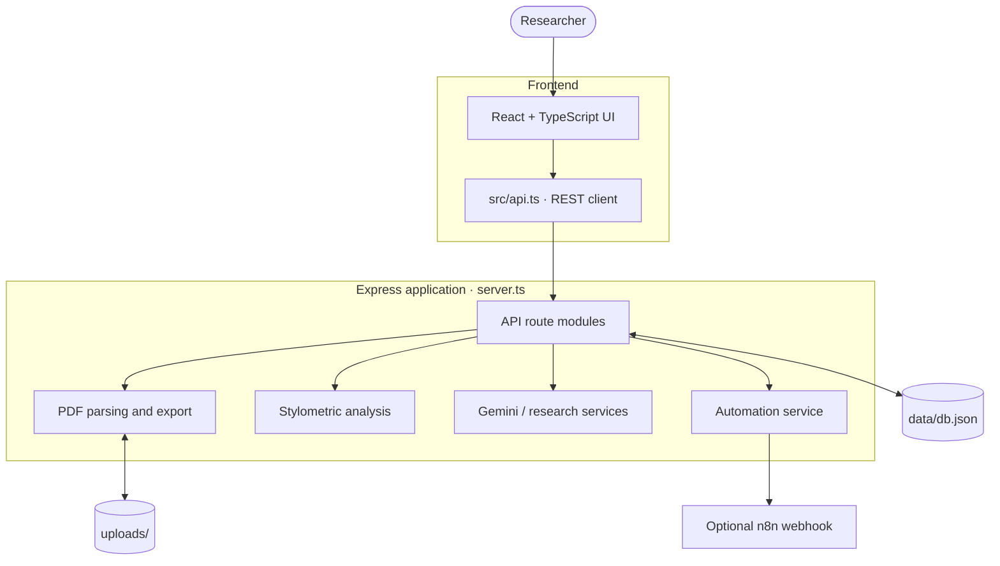
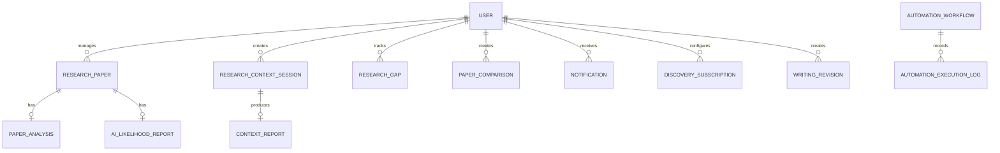

<!--
  ResearchLens README
  Keep this document GitHub-flavoured Markdown compatible.
-->

<div align="center">

# 🔎 ResearchLens

### Your research workspace, from papers to insights.

**Analyze academic PDFs · Explore research gaps · Compare studies · Improve scholarly writing**

<br />


[Features](#-what-you-can-do) · [Architecture](#-system-architecture) · [Setup](#-run-locally) · [API](#-api-at-a-glance) · [Deployment](#-deployment)

</div>

---

ResearchLens is a research-assistance platform designed to help students and researchers organize academic papers, understand literature, identify potential research gaps, compare studies, and refine scholarly writing in one workspace.

> [!IMPORTANT]
> AI-generated summaries and AI-likelihood scores are estimates—not proof of authorship or substitutes for checking the original research. Always review results critically.

## ✨ What you can do

<table>
<tr>
<td width="50%" valign="top">

### 📄 Paper Studio
- Upload and organize PDF research papers.
- Extract text, page information, and metadata.
- Detect duplicate files using SHA-256 hashes.
- Ask questions about a paper.
- Export paper reports and analysis data.

</td>
<td width="50%" valign="top">

### 🧭 Research Explorer
- Explore a topic or research question.
- Generate structured context reports.
- Discover and bookmark potential research gaps.
- Compare research papers and their findings.
- Search academic records through discovery tools.

</td>
</tr>
<tr>
<td width="50%" valign="top">

### 🧠 AI-Likelihood Analysis
- Inspect sentence-level linguistic signals.
- Review flagged passages and explanations.
- Explore page-level and document-level estimates.
- Export supported analysis and highlighted PDFs.

</td>
<td width="50%" valign="top">

### ✍️ Writing & Automation
- Improve scholarly text and review revisions.
- View dashboard analytics and notifications.
- Inspect automation workflows and execution logs.
- Connect n8n for external workflow automation.

</td>
</tr>
</table>

## 🧰 Technology stack

| Area | Technologies |
|---|---|
| Frontend | React 19, TypeScript, Vite |
| UI | Tailwind CSS, Motion, Lucide React |
| Backend | Node.js, Express, TypeScript, tsx |
| AI | Google GenAI SDK and Gemini API (when configured) |
| PDF tools | pdf-parse, pdfjs-dist, pdf-lib, Multer |
| Current persistence | Local JSON file: `data/db.json` |
| Uploaded files | Local `uploads/` directory |
| Optional workflows | n8n webhooks with local fallback behavior |

## 🏗️ System architecture

The application currently runs as a **single Node.js service**. In development, Express mounts Vite middleware; in production, Express serves the built frontend from `dist/`.



### Request lifecycle

1. A user action in the React interface calls the same-origin API client.
2. Express routes coordinate the request and invoke domain services.
3. PDF services extract document text; analysis features use Gemini when configured and may use local fallback logic where implemented.
4. Records are persisted to the JSON file, while uploaded PDFs are saved locally.
5. Automation events are sent to n8n when configured; local fallback behavior is available for some automation paths.

## 🗂️ Data model and ER diagram

ResearchLens currently stores records in a JSON document, **not a relational database**. This is a logical view of the domain entities and their relationships; the lines below do not represent database-enforced foreign keys.



| Logical collection | What it stores |
|---|---|
| `users` | Researcher profile information (the current app uses a default user model). |
| `papers` | Paper metadata, hash, extracted text, status, tags and analysis. |
| `contextSessions` | Research questions, generated reports and conversation history. |
| `gaps` | Potential research gaps, categories and bookmark/status information. |
| `comparisons` | Paper comparison requests and results. |
| `executionLogs` | Automation status, results, retries and timestamps. |
| `notifications` | Notification messages, read state and timestamps. |
| `subscriptions` | Academic discovery subscription settings. |
| `revisions` | Original text, revised text, mode and explanation. |

Some reports and messages are nested within parent records rather than stored as separate collections. See `server/types.ts` and `server/db.ts` for the implementation details.

## 📁 Project structure

```text
ResearchLens_0.1/
├── src/
│   ├── App.tsx                 # Main application views and state
│   ├── api.ts                  # Frontend REST API client
│   ├── types.ts                # Frontend TypeScript types
│   └── components/             # Dashboard, papers, analysis, writing, etc.
├── server.ts                   # Express entry point and Vite/static hosting
├── server/
│   ├── db.ts                   # JSON persistence layer
│   ├── gemini.ts               # Gemini integration and fallbacks
│   ├── academic.ts             # Academic discovery integration
│   ├── pdfService.ts            # PDF text extraction and hashing
│   ├── n8nService.ts             # n8n dispatch and local fallback
│   ├── benchmarkData.ts         # AI-likelihood benchmark data
│   ├── routes/                  # API route modules
│   └── services/
│       ├── aiDetectionService.ts
│       └── pdfHighlightService.ts
├── data/
│   └── db.json                  # Local JSON data (do not commit real user data)
├── uploads/                     # Runtime PDF uploads
├── .env.example
├── package.json
├── vite.config.ts
└── tsconfig.json
```

## 🚀 Run locally

### 1. Prerequisites

- Node.js (a current LTS version is recommended).
- npm.
- A [Gemini API key](https://aistudio.google.com/apikey) for Gemini-backed features.
- Optional: an accessible n8n instance for external automation.

### 2. Clone the repository

The repository is private, so your GitHub account must have access.

```bash
git clone https://github.com/amitpaul2004/ResearchLens_0.1.git
cd ResearchLens_0.1
```

### 3. Install dependencies

```bash
npm install
```

### 4. Configure environment variables

Copy the example file.

**Windows PowerShell**
```powershell
Copy-Item .env.example .env
```

**macOS / Linux**
```bash
cp .env.example .env
```

Open `.env` and fill in the values you need:

```dotenv
GEMINI_API_KEY=your_gemini_api_key
APP_URL=http://localhost:3000

# Optional: only configure these if connecting n8n
N8N_WEBHOOK_URL=
N8N_WEBHOOK_SECRET=
```

Keep secrets in the server environment. Never commit your actual `.env` file or place private API keys in frontend code.

### 5. Start the development server

```bash
npm run dev
```

Open the app at **http://localhost:3000**.

Health check: [http://localhost:3000/api/health](http://localhost:3000/api/health)

Stop the server with `Ctrl+C`.

### 6. Build and run in production mode locally

Build the frontend:

```bash
npm run build
```

**Windows PowerShell**
```powershell
$env:NODE_ENV = "production"
npm start
```

**macOS / Linux**
```bash
NODE_ENV=production npm start
```

### Available scripts

| Command | Purpose |
|---|---|
| `npm run dev` | Development server with Vite middleware. |
| `npm run build` | Build frontend assets into `dist/`. |
| `npm start` | Start the Express server. Set `NODE_ENV=production` to serve the production frontend. |
| `npm run lint` | TypeScript check (`tsc --noEmit`), according to the package scripts. |
| `npm run preview` | Vite preview server; it does not replace Express for API routes. |

## 🔐 Environment variables

| Variable | Purpose |
|---|---|
| `GEMINI_API_KEY` | Server-side key for Gemini-backed features. |
| `APP_URL` | Public base URL used by some n8n workflow callback definitions. |
| `N8N_WEBHOOK_URL` | Optional n8n webhook endpoint/configuration. |
| `N8N_WEBHOOK_SECRET` | Shared secret sent using the `X-ResearchLens-Secret` header. Configure a unique secret in both systems. |

**Security note:** the current n8n service contains a hard-coded fallback secret when the environment variable is missing. Do not rely on that default. Set a unique secret and change the service to fail closed in production if it is not configured.

## 🔌 API at a glance

The application mounts these route groups in `server.ts`. Most endpoints use the `/api/v1` prefix.

| Area | Base path | Common actions |
|---|---|---|
| Health | `GET /api/health` | Health status. |
| User and analytics | `/api/v1` | Current default user, system status, dashboard analytics. |
| Papers | `/api/v1/papers` | Upload/list/view papers, paper chat, AI-likelihood analysis, exports and deletion. |
| Research context | `/api/v1/research/context` | Analyze topics; list, update, chat with and delete sessions. |
| Research gaps | `/api/v1/research/gaps` | Discover, list, update and delete gaps. |
| Comparisons | `/api/v1/research/compare` | Run and view paper comparisons. |
| Academic discovery | `/api/v1/research/academic` | Search academic works and manage subscriptions. |
| Writing | `/api/v1/writing` | Improve text and view revisions. |
| Automation | `/api/v1/automation` | Workflows, logs, triggers, retries and configuration. |

### Example: upload a PDF

The upload endpoint accepts multipart form data using the field name `papers`. It supports up to five PDF files per request, with a 30 MB limit per file.

```bash
curl -X POST http://localhost:3000/api/v1/papers/upload \
  -F "papers=@./sample-paper.pdf"
```

## 💾 Data and file storage

- Structured records: `data/db.json`.
- Uploaded PDF files: `uploads/`, served under `/uploads`.
- Current JSON storage rewrites the data file after updates. This is suitable for a prototype or a small single-instance demo, not concurrent production workloads.
- Scanned PDFs may require OCR before their contents can be analyzed reliably.

> [!WARNING]
> Repository inspection found a tracked `data/db.json` file of approximately 10.9 MB. Review it for real user information or private research content before sharing the repository. Remove sensitive data from Git and review the repository history as well; deleting the latest copy does not remove earlier commits.

For production, migrate structured records to a durable database (for example, PostgreSQL) and PDFs to persistent disk or object storage. Local files can disappear on hosting platforms that use ephemeral filesystems.

## ☁️ Deployment

For a demo deployment, use one Node web service because Express serves both the API and the production frontend.

Suggested configuration:

| Setting | Value |
|---|---|
| Build command | `npm install && npm run build` |
| Start command | `npm start` |
| Environment | `NODE_ENV=production` |
| Health check | `/api/health` |

The current source uses a fixed port, `3000`. For hosts that supply a `PORT` environment variable, update `server.ts` to use:

```ts
const PORT = Number(process.env.PORT) || 3000;
```

For Render, follow the current [Web Services guide](https://render.com/docs/web-services) and [Persistent Disks guide](https://render.com/docs/disks). Configure secrets in the hosting dashboard, not in Git.

### Before public production use

- [ ] Remove real user/research data from source control and inspect Git history.
- [ ] Implement authentication and per-user authorization.
- [ ] Replace JSON-file persistence with a durable database.
- [ ] Configure durable file storage and backups.
- [ ] Replace the default n8n secret with a unique secret.
- [ ] Add appropriate rate limits, monitoring and error handling.
- [ ] Test build, uploads, AI integrations and persistence in the target environment.

## ⚠️ Limitations and responsible use

- **AI-likelihood scores are estimates.** False positives and false negatives are possible; never treat a score as definitive evidence of authorship.
- **Authentication is incomplete.** The current user endpoint returns a default user model, not a full login/session implementation. Do not expose private records publicly until access control is implemented.
- **Local storage is not production-grade.** A JSON file and local upload directory do not provide the reliability or concurrency control of a managed database and object store.
- **AI services may fall back.** Some features have fallback behavior when external AI services are unavailable; verify the mode and provenance of results.
- **Validation status:** this README was prepared by inspecting the repository source. Build and runtime tests were not executed as part of the documentation update.

## 🤝 Contributing

1. Create a feature branch.
2. Keep API keys, personal data, PDFs and live database files out of Git.
3. Make focused changes and update relevant documentation.
4. Run `npm run lint` and `npm run build`.
5. Submit a pull request with a clear summary and test notes.

## 📄 License

No license file was present when this README was reviewed. Until a license is added, permissions to reuse, modify or redistribute the code are not explicitly granted. Add a license that reflects the project's intended usage before describing it as open source.

---

<div align="center">

**ResearchLens** · A clearer workflow for academic research.

<sub>Built for exploration, analysis, and better-informed research decisions.</sub>

</div>
